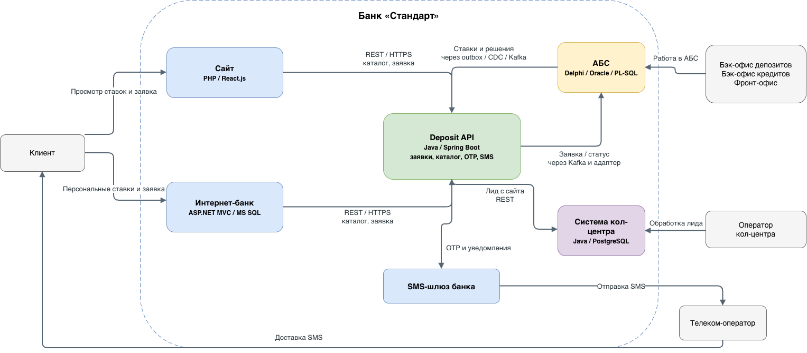
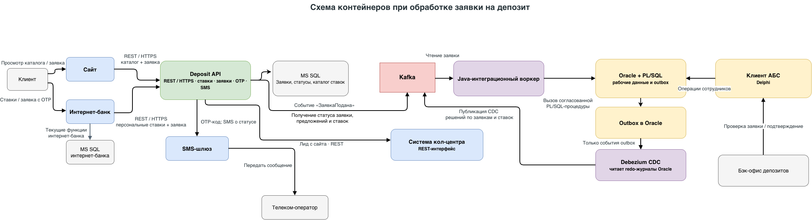

### **Название задачи:** Онлайн-подача заявок на депозит через сайт и интернет-банк с обработкой в бэк-офисе.
### **Автор:** Константин Чернов
### **Дата:** 2026-10-14
### **Функциональные требования**

|**№**|**Действующие лица или системы**|**Use Case**|**Описание**|
| :-: | :- | :- | :- |
| UC-1 | Потенциальный клиент, сайт, Deposit API, система кол-центра | Подать заявку на депозит на сайте | Клиент оставляет Ф. И. О. и телефон. Заявка сохраняется и передаётся в систему кол-центра. Оператор связывается с клиентом и может предложить особые условия. Новый клиент затем проходит идентификацию в отделении |
| UC-2 | Клиент, интернет-банк, Deposit API, SMS-шлюз | Подать заявку на депозит в интернет-банке | Клиент видит доступные и персональные ставки, выбирает счёт и сумму. Подтверждает отправку одноразовым SMS-кодом. Сервис проверяет код и регистрирует заявку |
| UC-3 | Бэк-офис депозитов, АБС, Deposit API | Обработать заявку на депозит | Сотрудник проверяет заявку и подтверждает условия в АБС. В MVP обработка остаётся ручной. АБС остаётся системой учёта депозита и финансовой операции |
| UC-4 | Бэк-офис кредитов и депозитов, АБС, интеграционный адаптер | Обновить и опубликовать ставки | Уполномоченные сотрудники ведут ставки в АБС с разделением доступа к данным подразделений. Адаптер публикует утверждённый каталог ставок и доступные клиентские предложения в сервис онлайн-заявок |
| UC-5 | АБС, Deposit API, SMS-шлюз, клиент | Получить уведомление | После подтверждения ставки и открытия депозита сервис получает статус из АБС и отправляет клиенту SMS через существующий шлюз банка и телеком-оператора |

### **Нефункциональные требования**

|**№**|**Требование**|
| :-: | :- |
| R1 | Новые онлайн-компоненты и интернет-банк должны поддерживать работу 24/7 и доступность 99,9%; интернет-банк должен переключаться на резервный ЦОД |
| R2 | Новые сервисы должны масштабироваться горизонтально. Взаимодействие с АБС ограничивается контролируемым асинхронным потоком, поскольку её БД перегружена и масштабируется вертикально |
| P1 | Клиентские операции должны отвечать быстро, порядка миллисекунд. Новая заявка не должна ждать синхронной обработки в АБС |
| S | Использовать технологии, совместимые с банковской платформой и компетенциями сотрудников; подготовить документацию и обеспечить дальнейшее расширение |
| +R | Сайт и интернет-банк передают чувствительные данные только по защищённому каналу (TLS). Доступ сотрудников к данным депозитного и кредитного направлений разделяется по ролям. Операции подтверждения и изменения статуса аудируются |

### **Решение**

**Диаграммы**: 
*Контекст C4*

*Контейнеры C4*

Отдельный сервис онлайн-заявок на депозиты (Deposit API).

- Сайт и монолит интернет-банка вызывают Deposit API по REST/HTTPS. Для существующих платежей и открытия текущих счетов сохраняется текущая интеграция с АБС; новый процесс депозитов через неё не проходит
- Deposit API реализуется на Java/Spring Boot: в банке есть специалисты с Java-экспертизой, а стек совместим с интеграционными компонентами кол-центра. Сервис хранит заявки и статусы в отдельной БД MS SQL, чтобы не нагружать Oracle АБС и БД интернет-банка
- Для асинхронного обмена используется Kafka. Отдельный Java-интеграционный воркер принимает сообщения с заявками, отправленными из Deposit API в Kafka, вызывает процедуры PL-SQL для заведения заявки в АБС. Сотрудники бэк-офиса продолжают работать в АБС.
- В АБС публикуются только разрешённые ставки и клиентские предложения. Данные также публикуются в outbox таблицу; CDC-коннектор Debezium отслеживает изменения outbox через журналы Oracle и публикует их в Kafka, откуда потом их забирает Deposit API и сохраняет в свою БД MS SQL.
- Заявки, по которым принято решение, публикуются в outbox таблицу в БД АБС; CDC-коннектор Debezium отслеживает изменения outbox через журналы Oracle и публикует их в Kafka. Deposit API читает решения по заявкам из Kafka и сохраняет на своей стороне.
- Заявки с сайта передаются в систему банковского кол-центра для обратного звонка. Для этого потребуется согласованный REST-интерфейс или адаптация микросервиса кол-центра (участие подрядчика нужно подтвердить на этапе планирования)
- Одноразовый SMS-код, его проверка, срок действия и лимит попыток реализуются в Deposit API. Код отправляется через существующий SMS-шлюз. Это позволяет не менять ядро интернет-банка ради SMS-функции
- Deposit API отправляет клиенту СМС-сообщения о подтверждённой ставке и открытии депозита после получения статусов из АБС через Kafka.
- Компоненты, обслуживающие онлайн-каналы, разворачиваются в банковской инфраструктуре с балансировкой и резервированием по ЦОД. Синхронный REST используется только для клиентского запроса и быстрой регистрации; обработка в АБС — асинхронная

### **Альтернативы**

1. **Прямое синхронное обращение интернет-банка к АБС.** Усиливает нагрузку на перегруженную Oracle БД, связывает доступность клиентского канала с АБС и повторяет существующее тесное сопряжение. Не выбирается.
2. **Добавить весь процесс в монолит интернет-банка.** Требует изменения подрядного ядра для SMS и процесса обработки; затрудняет независимое масштабирование и развитие.
3. **Использовать систему кол-центра как хранилище и процессор всех депозитных заявок.** Система принадлежит процессу кол-центра и не должна становиться источником истины по ставкам и открытию депозитов.
4. **Передавать заявки пакетами через файлы/email.** Минимальные изменения, но слабая наблюдаемость, задержки и риск потери/дублирования; не подходит для статусов онлайн-заявок.

**Недостатки, ограничения, риски**

- Kafka, Deposit API, отдельная БД, адаптер и CDC-коннектор увеличивают стоимость разработки и эксплуатации; нужны мониторинг, резервирование, управление схемами сообщений и поддержка 24/7.
- Интеграция с АБС требует участия её команды и тестирования PL/SQL-интерфейса. Даже асинхронная запись в Oracle создаёт нагрузку.
- Асинхронный обмен означает eventual consistency: клиент может увидеть статус «заявка принята» до её появления в АБС. Нужны понятные статусы, повторные доставки, DLQ и идемпотентность.
- Зависимость от подрядчика кол-центра может повлиять на сроки интеграции. Если API недоступно, нужно согласовать временный ручной маршрут и контроль необработанных заявок.
