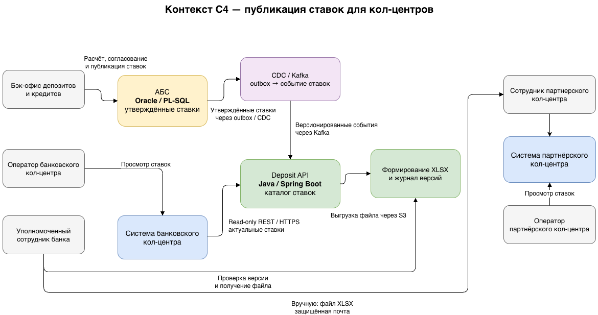
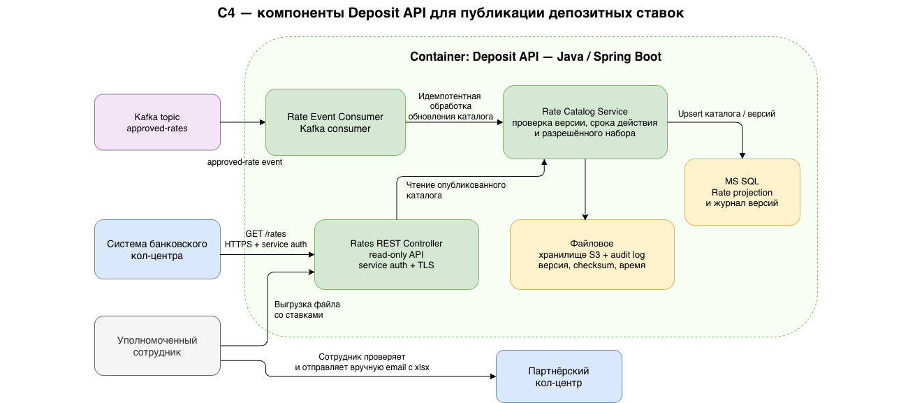
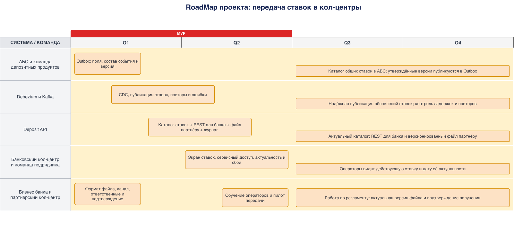

### **Название задачи:** Передача актуальных депозитных ставок в банковский и партнёрский кол-центры
### **Автор:** Константин Чернов
### **Дата:** 2026-10-15
### **Функциональные требования**

|**№**|**Действующие лица или системы**|**Use Case**|**Описание**|
| :-: | :- | :- | :- |
| UC-1 | Сотрудник банковского кол-центра, система кол-центра, Deposit API | Узнать актуальную ставку | Сотрудник ищет депозитный продукт и получает из системы кол-центра актуальные опубликованные ставки и основные условия. Система кол-центра получает данные из Deposit API по внутреннему REST-интерфейсу только для чтения. |
| UC-2 | Сотрудник партнёрского кол-центра, представитель банка | Получить ставки для консультаций | Уполномоченный сотрудник банка формирует актуальный файл со ставками и передаёт его партнёру по согласованному защищённому каналу. Сотрудник партнёрского кол-центра использует полученный файл при консультации клиентов. |
| UC-3 | АБС, Oracle Outbox, Debezium, Kafka, Deposit API | Опубликовать изменения ставок | После утверждения ставки в АБС изменение попадает в Outbox. Debezium публикует событие в Kafka, Deposit API обновляет свой каталог и использует его для банковского кол-центра и выгрузки файла партнёру. |

### **Нефункциональные требования**

|**№**|**Требование**|
| :-: | :- |
| R1 | Ставки в банковском кол-центре и в файле партнёра должны соответствовать последним утверждённым данным, опубликованным из АБС. Для файла указываются дата и время формирования, версия и срок актуальности. |
| R2 | Публикация ставок не должна создавать существенную дополнительную нагрузку на Oracle БД АБС; используется существующий асинхронный поток Outbox → Debezium → Kafka. |
| R3 | Сотрудники кол-центров получают только утверждённые ставки и условия, необходимые для консультации; доступ к изменению ставок и внутренним данным АБС не предоставляется. |
| R4 | REST-взаимодействие банковского кол-центра с Deposit API защищается TLS и сервисной аутентификацией. Файл партнёру передаётся по согласованному защищённому каналу; доступ и передача контролируются. |
| R5 | Сбой публикации или передачи файла должен обнаруживаться. Необходимы журналирование версий, контроль успешной доставки и процедура повторной отправки. |
| R6 | Каталог ставок и формирование файла должны масштабироваться независимо от АБС и не ухудшать доступность клиентских онлайн-сценариев. |

### **Решение**

**Диаграммы**: 
*Контекст C4*

*Компоненты C4*

В рамках MVP источником истины по ставкам остаётся АБС. Используется архитектура онлайн-заявки на депозит из ADR задания 3: утверждённые ставки публикуются из Oracle Outbox через Debezium в Kafka, после чего Deposit API обновляет собственный каталог в MS SQL. Новый процесс не обращается напрямую к базе АБС.

Для банковского кол-центра система кол-центра получает ставки из Deposit API по внутреннему REST/HTTPS-интерфейсу. Deposit API предоставляет только чтение опубликованного каталога; интерфейс ограничен сервисной аутентификацией и набором необходимых полей. Интеграция требует согласования интерфейса и участия команды подрядчика системы кол-центра.

Для партнёрского кол-центра Deposit API формирует файл CSV или XLSX с утверждёнными ставками и основными условиями. Файл содержит дату и время формирования, номер версии и срок актуальности. Поскольку партнёр не может принимать API-вызовы или SFTP, на MVP уполномоченный сотрудник банка проверяет и передаёт файл вручную по согласованному защищённому почтовому каналу. Получение подтверждается партнёром; версия, отправитель, время передачи и подтверждение регистрируются.

### **Альтернативы**

1. **Прямой доступ системы кол-центра к Oracle АБС.** Не выбирается: увеличивает нагрузку и связанность с перегруженной БД, а также требует выдавать внешней системе доступ к АБС.
2. **Синхронно получать ставки из АБС при каждом обращении.** Не выбирается: доступность консультации зависит от АБС и создаётся дополнительная нагрузка на неё.
3. **Передавать ставки партнёру через API или SFTP.** Не подходит для MVP: партнёрская система не может принимать API-вызовы и файлы по SFTP.
4. **Ручные письма со ставками без единого формата и версий.** Не выбирается: невозможно надёжно определить актуальную версию, отследить получение и исключить использование устаревших ставок.

**Недостатки, ограничения, риски**

- Ручная отправка файла партнёру создаёт задержку между изменением ставки в АБС и обновлением информации у операторов. На время задержки партнёр может использовать устаревшие данные; нужны срок актуальности и запрет консультации по просроченному файлу.
- Защищённый почтовый канал, шифрование, отдельная передача пароля и подтверждение получения должны быть согласованы с партнёром и информационной безопасностью до запуска. Если согласовать канал нельзя, запуск консультаций партнёрского кол-центра зависит от выбора другого разрешённого способа передачи файлов.
- REST-интеграция банковского кол-центра зависит от возможностей платформы подрядчика и сроков его команды.
- Kafka и CDC требуют сопровождения, мониторинга задержек, повторной обработки и контроля дубликатов. Deposit API должен применять события идемпотентно.
- Для файла необходимо определить владельца процесса, периодическую проверку актуальности и порядок срочного отзыва версии. Без назначенных ответственных контроль доставки будет ненадёжным.

### **RoadMap**
*Крупные задачи*

