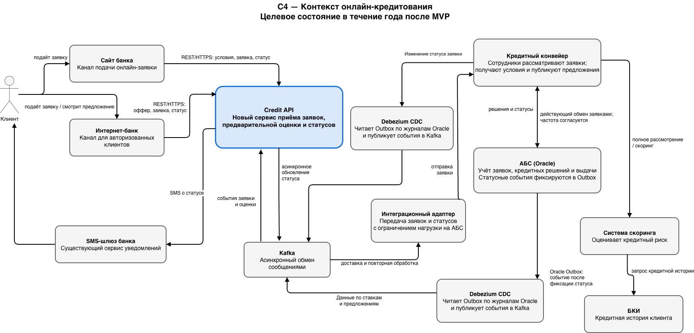
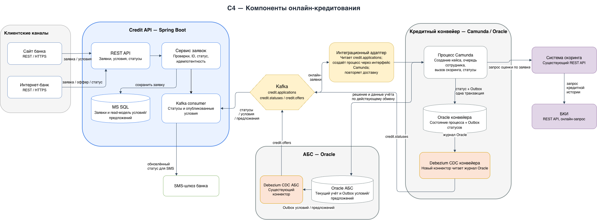

### **Название задачи:** Онлайн-подача заявок на кредит через сайт и интернет-банк.
### **Автор:** Константин Чернов
### **Дата:** 2026-10-17
### **Функциональные требования**

|**№**|**Действующие лица или системы**|**Use Case**|**Описание**|
| :-: | :- | :- | :- |
| UC-1 | Потенциальный клиент, сайт, Credit API | Подать заявку на сайте | Клиент видит опубликованные условия кредита и отправляет заявку с Ф. И. О. и телефоном. Для предварительной оценки он также указывает паспортные данные. Сервис регистрирует заявку и возвращает её номер и статус. |
| UC-2 | Клиент, интернет-банк, Credit API | Подать заявку по предодобренному предложению | Авторизованный клиент видит доступные ему условия и предодобренное предложение, если оно есть. После подтверждения сервис проверяет, не изменились ли данные для упрощённой повторной оценки, и регистрирует заявку. |
| UC-3 | Credit API, Kafka, интеграционный адаптер, Кредитный конвейер, система скоринга, БКИ | Получить предварительное решение для нового клиента | Credit API передаёт заявку через Kafka и адаптер непосредственно в Кредитный конвейер, не ожидая суточной передачи из АБС. Конвейер запускает скоринг, тот при необходимости запрашивает данные БКИ. Результат и статус возвращаются через Outbox Кредитного конвейера, Debezium CDC и Kafka в Credit API. Клиент получает результат и, если нужна идентификация, приглашение в отделение. |
| UC-4 | Сотрудник отделения, АБС, Кредитный конвейер | Продолжить заявку в отделении | Сотрудник находит онлайн-заявку по её номеру и продолжает обработку. Если онлайн-заявки нет, сотрудник создаёт заявку по действующему процессу. Клиент проходит идентификацию в отделении. |
| UC-5 | Credit API, Кредитный конвейер, Debezium CDC, Kafka, клиент, SMS-шлюз | Обработать заявку и сообщить об изменении статуса | Заявка поступает на обработку в Кредитный конвейер. При изменении статуса конвейер записывает событие в собственный Oracle Outbox; Debezium публикует его в Kafka. Credit API получает обновление и отправляет клиенту SMS через существующий шлюз. Решение и необходимые данные далее передаются в АБС по действующей интеграции. |
| UC-6 | Кредитный конвейер, Credit API, сайт, интернет-банк | Показать условия кредита и предодобренные предложения | Credit API получает опубликованные условия и разрешённые для показа предложения из кредитного контура, сохраняет их в своей БД и отдает по REST запросам. |

### **Нефункциональные требования**

|**№**|**Требование**|
| :-: | :- |
| R1 | Сайт, интернет-банк и новые компоненты должны быть доступны 24/7 с целевой доступностью 99,9%. Интернет-банк должен сохранять доступность при сбое основного ЦОД за счёт переключения на резервный. |
| P1 | Онлайн-канал должен быстро подтверждать регистрацию заявки; ожидание ответа АБС, скоринга или БКИ не должно блокировать запрос пользователя. |
| P2 | При достаточности данных решение по заявке должно быть получено в течение одного рабочего дня. Заявки по предодобренным предложениям должны попасть к сотрудникам на обработку в тот же рабочий день. |
| P3 | Новые сервисы должны горизонтально масштабироваться. Клиентские каналы не должны напрямую обращаться к БД или синхронному API АБС. |
| +R1 | Персональные и паспортные данные передаются по TLS и хранятся с применением утверждённых банком средств защиты. Доступ сотрудников к данным кредитного и депозитного направлений разделяется. |
| +R2 | Функции добавляются без существенной переработки подрядного ядра интернет-банка. Используются поддерживаемые в банке технологии; интерфейсы и регламенты документируются. |
| +R3 | Онлайн-заявки передаются асинхронно через Kafka и интеграционный адаптер непосредственно в Кредитный конвейер, минуя суточный обмен АБС → конвейер. Изменения статусов публикуются из Oracle Outbox Кредитного конвейера через отдельный Debezium CDC-коннектор в Kafka. Существующий CDC АБС остаётся отдельным источником событий АБС, например условий и предложений. Нужны идемпотентность, повторная доставка, контроль очереди, мониторинг задержки и оповещения. Kafka не встраивается в интернет-банк: каналы используют REST API. |

### **Решение**

**Диаграммы**:

*Контекст C4:*   
*Компоненты C4:* 

Вводится отдельный сервис онлайн-заявок на кредит — **Credit API** — на Java/Spring Boot с собственной БД. Java/Spring Boot уже используется в кредитном контуре и Deposit API; это позволяет развивать функцию вне подрядного ядра интернет-банка на .NET. Сервис обслуживает только новые сценарии подачи заявки и чтения опубликованных условий; он не заменяет АБС или Кредитный конвейер.

- Сайт и интернет-банк обращаются к Credit API по REST/HTTPS. Изменять логику подрядного ядра каналов не требуется; интернет-банк взаимодействует с сервисом через поддерживаемый внешний интерфейс.
- Credit API хранит заявки и их клиентские статусы в отдельной БД. Приём заявки подтверждается сразу, без ожидания скоринга и АБС. Повторная отправка одного запроса не создаёт дубликат.
- Публичные условия и предодобренные предложения сохраняются в БД сервиса Credit API. Персональное предложение доступно только авторизованному клиенту и только в объёме, разрешённом правилами банка.
- После регистрации онлайн-заявки Кредитный конвейер запускает предварительную оценку через существующую систему скоринга. Скоринг продолжает обращаться к БКИ онлайн и использовать доступные ему клиентские и кредитные данные. Результат оценки возвращается в рабочий процесс конвейера; ожидание скоринга не блокирует ответ канала о регистрации заявки.
- Credit API сохраняет заявку и отправляет событие `credit.applications` в Kafka; интеграционный адаптер получает его и создаёт заявку непосредственно в Кредитном конвейере через поддерживаемый интерфейс Camunda. Адаптер не записывает данные напрямую в Oracle и не проводит онлайн-заявку через суточный обмен с АБС. Кредитный конвейер остаётся системой обработки заявок сотрудниками.
- Для онлайн-заявок в Кредитном конвейере настраивается автоматический запуск предварительного скоринга: конвейер вызывает существующий REST API скоринга, а скоринг при необходимости обращается к БКИ онлайн. Внутренние данные скоринга по-прежнему обновляются из БД систем раз в сутки; массовые предварительные пересчёты не добавляются. Онлайн-заявки направляются сотрудникам в приоритетную очередь в день поступления.
- Действующий обмен между АБС и Кредитным конвейером сохраняется для заявок и операций, проходящих по текущему процессу; его суточное расписание не меняется. Решение по онлайн-заявке и данные для учёта передаются в АБС по действующей интеграции. Поэтому обработка сотрудником может начаться в тот же день, но отражение результата в АБС может произойти позднее.
- При изменении статуса Кредитный конвейер записывает событие в собственный Oracle Outbox в той же транзакции, что и бизнес-изменение. Новый Debezium CDC-коннектор читает журнал Oracle конвейера и публикует событие `credit.statuses` в Kafka. Credit API потребляет его, обновляет статус заявки и отправляет SMS через существующий шлюз. Существующий CDC АБС остаётся отдельным потоком для событий АБС, например условий и предложений. В события передаются только необходимые поля; доставка и уведомление повторяются при временной ошибке.
- Заявка, принятая онлайн, получает единый идентификатор для поиска в отделении. После переноса в АБС сотрудник продолжает её по действующему процессу. Идентификация нового клиента и выдача кредита остаются в отделении и АБС.

### **Альтернативы**

1. **Сайт и интернет-банк обращаются напрямую к АБС.** Не выбирается: создаёт синхронную нагрузку на перегруженную Oracle БД и связывает доступность онлайн-каналов с доступностью АБС.
2. **Добавить онлайн-кредитование в ядро интернет-банка.** Не выбирается: ядро зависит от подрядчика, усложняется выпуск изменений, а кредитная логика и SMS тесно связываются с каналом.
3. **Использовать Кредитный конвейер как публичный API для сайта и интернет-банка.** Не выбирается: конвейер предназначен для сотрудников; публичный трафик, клиентская аутентификация и хранение заявок смешали бы разные зоны ответственности и уровни нагрузки.
4. **Оставить подачу и передачу заявок через Excel и электронную почту.** Не выбирается: нет управляемых статусов, сложнее обеспечить срок обработки, повторную доставку и безопасную передачу персональных данных.
5. **Вызывать скоринг синхронно из сайта или интернет-банка.** Не выбирается: внешние зависимости увеличивают время ответа и делают подачу заявки недоступной при сбое скоринга или БКИ.

**Недостатки, ограничения, риски**

- Появляется новый сервис и отдельная БД; потребуются сопровождение 24/7, мониторинг, резервирование, управление схемами сообщений и поддержка повторной обработки.
- АБС остаётся узким местом кредитного процесса. Онлайн-заявка обходит её на пути в Кредитный конвейер, а суточный обмен АБС ↔ конвейер не ускоряется. Это снижает влияние АБС на срок передачи заявки, но отражение решения и выдача кредита в АБС могут произойти позднее.
- Для Outbox и Debezium нужны права доступа к журналам Oracle, настройка retention и мониторинг задержки. Для Outbox Кредитного конвейера потребуется отдельный Debezium-коннектор; это дополнительная интеграция, которую нужно согласовать с подрядчиком и внутренней командой конвейера.
- Целевой срок обработки сотрудником обеспечивается прямой доставкой онлайн-заявки в Кредитный конвейер и приоритетной очередью. Суточная интеграция АБС ↔ конвейер остаётся без изменений; если бизнес требует также отражать решение и выполнять выдачу в АБС в тот же день, понадобится отдельный согласованный канал для этих операций.
- Предварительная оценка не является окончательным одобрением кредита. Для нового клиента необходимо лично пройти идентификацию в отделении; окончательное решение принимает сотрудник по действующим правилам.
- До проектирования нужно подтвердить поддерживаемый интерфейс создания заявки в Кредитном конвейере и возможность автоматического запуска скоринга. Нужно согласовать с командой конвейера и подрядчиком Oracle Outbox для статусов и отдельный Debezium-коннектор; с командой АБС — действующий Outbox/CDC для событий АБС. Прямая запись адаптера в таблицы Кредитного конвейера не используется.
- Необходимо определить правовое основание, минимальный состав, сроки хранения и правила удаления паспортных данных; исключить их попадание в журналы и диагностические сообщения.
- При задержке интеграции клиент видит сохранённый статус «заявка принята» или «обрабатывается». Срок актуальности условий и текст сообщений должны исключать обещание кредита до окончательного решения.
